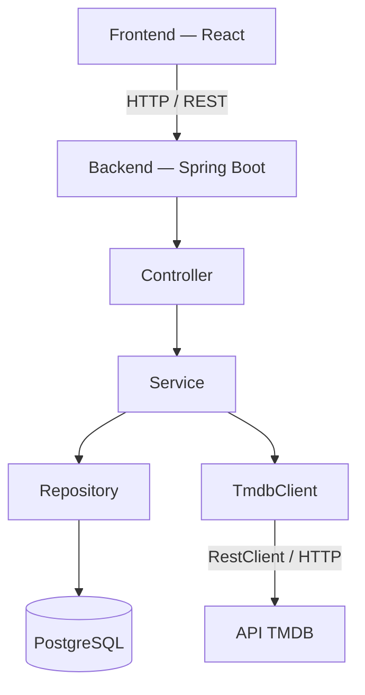

# OurMovies — Backend

API REST desenvolvida em **Java 21 e Spring Boot**, responsável pelo gerenciamento de uma coleção de filmes compartilhada por um casal, permitindo organizar filmes assistidos, criar listas de desejos, registrar avaliações individuais e calcular a média das notas.

O projeto utiliza uma **arquitetura em camadas**, com persistência em PostgreSQL e integração com a API externa **TMDB (The Movie Database)** por meio do Spring RestClient, possibilitando consultar automaticamente informações dos filmes.

---

## Arquitetura do Sistema

O backend é responsável por processar as requisições do frontend React, aplicar as regras de negócio e realizar a comunicação com o PostgreSQL e a API TMDB.



### Organização do Backend

O projeto segue uma arquitetura em camadas, com responsabilidades separadas.

| Camada | Responsabilidade |
|---|---|
| Controller | Recebimento e processamento de requisições HTTP |
| Service | Implementação das regras de negócio |
| Repository | Persistência e consulta de dados utilizando JPA |
| Entity | Representação das entidades do banco de dados |
| DTO | Transferência e validação de dados da API |
| Client | Comunicação com serviços externos |
| Config | Configurações e inicialização da aplicação |
| Exception | Tratamento centralizado de exceções |

---

## Funcionalidades

- **Pesquisa de filmes:** integração com a API TMDB para consultar filmes pelo título.
- **Informações automáticas:** obtenção de sinopse, pôster, gêneros e data de lançamento.
- **Coleção compartilhada:** gerenciamento de filmes assistidos e filmes para assistir.
- **Favoritos:** possibilidade de marcar e desmarcar filmes favoritos.
- **Avaliações individuais:** registro de notas e comentários dos dois usuários.
- **Média do casal:** cálculo automático da média das avaliações.
- **Gerenciamento de avaliações:** criação, consulta, atualização e exclusão.
- **Personalização de usuários:** edição de nomes e gerenciamento de fotos de perfil.
- **Validação de dados:** prevenção de registros inválidos e duplicados.
- **Tratamento de exceções:** respostas HTTP padronizadas.
- **Persistência:** armazenamento das informações no PostgreSQL.

---

## Tecnologias Utilizadas

| Tecnologia | Aplicação |
|---|---|
| Java 21 | Linguagem de programação |
| Spring Boot 4 | Desenvolvimento da API REST |
| Spring Web MVC | Requisições e endpoints HTTP |
| Spring Data JPA | Persistência e acesso ao banco |
| Hibernate | Mapeamento objeto-relacional |
| PostgreSQL | Banco de dados relacional |
| Spring RestClient | Integração com a API TMDB |
| Bean Validation | Validação de dados |
| Lombok | Redução de código repetitivo |
| Gradle | Gerenciamento de dependências |
| JUnit | Testes automatizados |
| H2 | Banco de dados utilizado nos testes |

---

## Integração com a API TMDB

O OurMovies utiliza o **TMDB (The Movie Database)** para pesquisar filmes e recuperar automaticamente suas informações.

### Fluxo de Funcionamento

1. O frontend envia uma pesquisa ao backend.
2. O Controller recebe a requisição HTTP.
3. O Service processa a solicitação.
4. O TmdbClient realiza a comunicação com a API TMDB.
5. O TMDB retorna as informações dos filmes.
6. O backend transforma os dados em DTOs e retorna o resultado ao frontend.
7. Quando um filme é adicionado à coleção, suas informações são persistidas no PostgreSQL.

A integração utiliza o **Spring RestClient**, permitindo comunicação HTTP com a API externa.

A chave de acesso ao TMDB é armazenada em uma variável de ambiente, sem ser exposta ao frontend.

---

## Banco de Dados

O projeto utiliza **PostgreSQL** para armazenar usuários, filmes, listas e avaliações.

### Entidades

| Entidade | Responsabilidade |
|---|---|
| Usuario | Armazena os perfis dos dois usuários |
| Filme | Armazena as informações dos filmes |
| FilmeLista | Controla status, favoritos e datas |
| Avaliacao | Registra notas e comentários |
| StatusFilme | Define os estados ASSISTIDO e QUERO_ASSISTIR |

### Relacionamentos

- Um usuário pode realizar várias avaliações.
- Um filme pode receber avaliações dos dois usuários.
- Cada filme pode aparecer apenas uma vez na coleção compartilhada.
- Cada usuário pode avaliar um mesmo filme apenas uma vez.
- Os gêneros são armazenados em uma tabela auxiliar relacionada aos filmes.

O mapeamento das entidades é realizado utilizando **JPA e Hibernate**.

---

## Endpoints da API

A aplicação disponibiliza endpoints REST para gerenciar filmes, listas, avaliações e usuários.

### Filmes

| Método | Endpoint | Descrição |
|---|---|---|
| GET | `/api/filmes/pesquisar` | Pesquisa filmes no TMDB |
| GET | `/api/filmes/{tmdbId}/detalhes` | Consulta detalhes de um filme |

### Coleção

| Método | Endpoint | Descrição |
|---|---|---|
| GET | `/api/lista` | Consulta a coleção |
| POST | `/api/lista/{tmdbId}` | Adiciona um filme |
| PATCH | `/api/lista/{id}` | Atualiza informações da lista |
| DELETE | `/api/lista/{id}` | Remove um filme da coleção |

### Avaliações

| Método | Endpoint | Descrição |
|---|---|---|
| POST | `/api/avaliacoes` | Registra uma avaliação |
| GET | `/api/avaliacoes/filme/{filmeId}` | Consulta avaliações de um filme |
| PUT | `/api/avaliacoes/{id}` | Atualiza uma avaliação |
| DELETE | `/api/avaliacoes/{id}` | Exclui uma avaliação |

### Usuários

| Método | Endpoint | Descrição |
|---|---|---|
| GET | `/api/usuarios` | Consulta os usuários |
| PATCH | `/api/usuarios/{id}` | Atualiza o nome |
| POST | `/api/usuarios/{id}/foto` | Envia ou substitui a foto |
| GET | `/api/usuarios/{id}/foto` | Consulta a foto |
| DELETE | `/api/usuarios/{id}/foto` | Remove a foto |

---

## Como Executar

### Pré-requisitos

- Java 21
- PostgreSQL
- Git
- Gradle Wrapper
- Chave de API TMDB

### 1. Clone o repositório

```bash
git clone https://github.com/arthurcoelho04/OurFilms.git
```

### 2. Configure o PostgreSQL

Crie um banco de dados chamado:

```text
ourmovies
```

O projeto utiliza scripts SQL de inicialização e validação do esquema pelo Hibernate.

### 3. Configure as variáveis de ambiente

No PowerShell, dentro da pasta do projeto:

```powershell
$env:DB_URL = 'jdbc:postgresql://localhost:5432/ourmovies'
$env:DB_USERNAME = 'postgres'
$env:DB_PASSWORD = 'SUA_SENHA'
$env:TMDB_API_KEY = 'SUA_CHAVE_TMDB'
```

Substitua os valores pelas suas credenciais locais.

A chave do TMDB pode ser obtida em:

https://www.themoviedb.org/settings/api

As credenciais não devem ser adicionadas diretamente ao código-fonte ou enviadas ao GitHub.

### 4. Inicie a aplicação

No Windows:

```powershell
.\gradlew.bat bootRun
```

No Linux ou macOS:

```bash
./gradlew bootRun
```

### 5. Acesse a API

Após iniciar o Spring Boot, a aplicação estará disponível em:

```text
http://localhost:8080
```

A API poderá ser utilizada pelo frontend React, executado normalmente em:

```text
http://localhost:5173
```

---

## Testes Automatizados

O projeto possui testes automatizados utilizando **JUnit e H2**, permitindo verificar as principais regras de negócio e operações da API.

Para executar os testes:

```powershell
.\gradlew.bat test
```

Para executar os testes e gerar o arquivo JAR:

```powershell
.\gradlew.bat clean test bootJar
```

Os testes utilizam um banco H2 e simulam a integração externa, sem depender de uma conexão real com o TMDB.

---

## Projeto Relacionado

Este repositório contém o **backend da aplicação OurMovies**, responsável pelas regras de negócio, persistência e integração com o catálogo de filmes.

O frontend é desenvolvido separadamente em **React e Vite**, consumindo os endpoints REST disponibilizados pelo Spring Boot.

---

## Autor

**Arthur Coelho**

[GitHub](https://github.com/arthurcoelho04)
